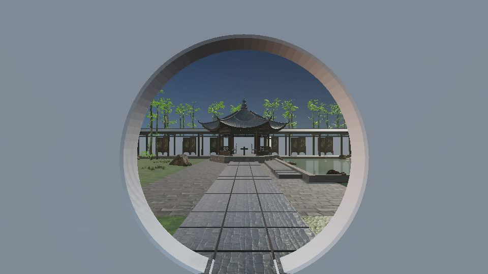
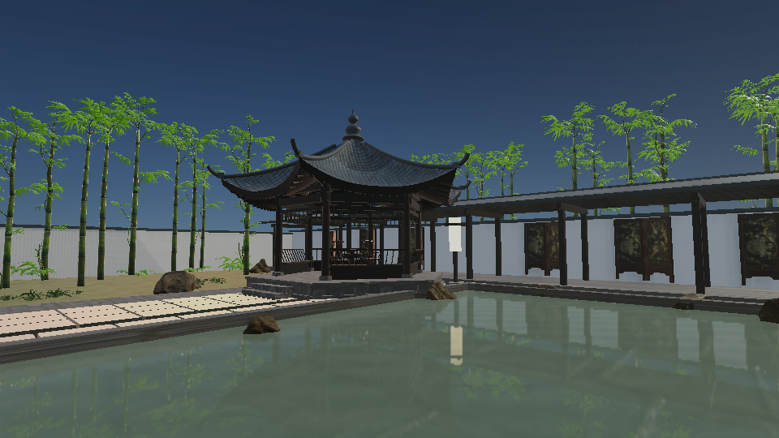
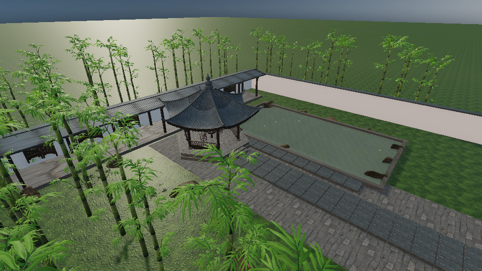

# 竹隐 · 中国风竹林庭院 Showcase

项目：`examples/chinese-courtyard-showcase.arkglide`。这是一个完全本地打包的可编辑场景，使用 JavaScript ES Modules 控制相机、画质与诊断。浏览器运行时不依赖素材 CDN。

以下为实际独立网页运行截图（Chromium / SwiftShader，960×540，High），未作画面修饰。资产署名见文末清单；软件渲染截图不能代替真实 GPU 性能验收。





## 打开与运行

1. 在仓库执行 `npm install`，然后 `npm run dev`。
2. 编辑器菜单 → 导入项目，选择 `examples/chinese-courtyard-showcase.arkglide`。
3. 点击「运行」。也可以选中各个分区，编辑模型、材质、光照、反射面和脚本。

操作：WASD 移动，拖动鼠标查看，Q/E 升降，Shift 加速；「鼠标锁定」按钮开启锁定，Esc 退出。**这是自由飞行观景相机，没有行走碰撞或游戏目标。**移动范围受庭院边界限制。

| 快捷键 | 操作 |
| --- | --- |
| 1 / 2 / 3 | Low / Medium / High |
| 4 / 5 / 6 / 7 / 8 | 月洞门 / 亭前 / 池边 / 竹径 / 高视角 |
| M | 开始／退出自动巡游 |
| T | TAA / FXAA |
| R | SSR |
| P | 水面平面反射 |
| V | 体积晨雾 |
| B | 探针每帧预算：1 面／4096 像素 ↔ 2 面／32768 像素 |
| H | 隐藏／显示界面，便于截图 |

底部按钮提供画质、巡游、下一机位与鼠标锁定。画质切换会重置这一档的效果开关；独立开关只改变当前运行会话，停止运行后保留编辑器内原始配置。D 保留为向右移动。

## 布局与展示点

```text
北                          北侧白墙与青瓦回廊
                  竹林        六角听雨亭       竹林
西侧竹林、林径                中轴园路        映池水面
望园阶台 / 高机位                            苔石池岸
                  竹林        月洞门入口       竹林
南                            初始视角
```

庭院占地约 36×38 米，竹林延伸到院墙外。层级中有「林地与基座」「月洞门入口」「听雨庭院」「映池水景」「竹林分块」「望园台」六个分区。静态 GLB 与场景节点分别保留；12 个竹林分块共 72 株作者制作的竹子，分块各三个材质网格；池岸 48 株扫描蕨类、回廊 12 扇雕花屏风、亭内两把中式扶手椅。

- TAA 与原生运动向量：对比细竹、栏杆和斜向园路边缘；切换机位时显式重置历史。
- 实时反射探针：仅池岸局部范围，128²、2 秒更新间隔，分帧捕获，避免整个庭院反复生成大立方体。
- SSR：池面与湿石屏幕内反射；High 启用，使用降采样控制成本。
- 平面反射：只有 `StillWater` 一个反射面。反射探针和 SSR 分别解决局部环境与屏幕内细节。
- 场景折射：水面使用 IOR=1.333、薄层吸收，池床能透过水面进入场景捕获。
- 晨雾与局部体积灯：方向光照亮轻薄高度雾；灯笼提供最多一个局部散射灯。
- 高级 PBR：真实扫描的 albedo／normal／ARM、湿石清漆、竹叶裁剪及轻微 sheen。
- 实例批次：园路、重复木构、栏杆等显式选择；与探针体积相交的节点安全保留独立绑定。
- 静态 LOD：18 个扫描岩石及两把扶手椅各两级。竹杆和叶卡片采用低面数分块；顶点聚类不适合细杆，因此不对竹林声明无效 LOD。

云、景深、分层透明默认关闭：没有需要层叠玻璃的场景，叶片使用 alpha test；自由浏览保持全景清晰。没有为了特性数量叠加额外特效。

## 可复现生成与导出

```bash
# 用已提交整理资源重建项目；不联网，不需要 Blender。
npm run example:courtyard

# 从锁定的素材 URL 重建资源，需能联网下载 GitHub 原文件。
# 离线缓存模式：npm run assets:courtyard -- --offline
# 需 Python + Pillow；three.js 只是离线准备依赖。
npm run assets:courtyard

# 导出到一个尚不存在或为空的新目录，并附带许可、清单和说明。
npm run export:courtyard -- work/my-courtyard-static

# 启动本地静态服务器；不要直接 file:// 双击 index.html。
node scripts/serve-static.mjs work/my-courtyard-static

# 浏览器验收：只生成这一份示例导出，不进行生产构建。
# 可通过 PLAYWRIGHT_CHROMIUM_EXECUTABLE 指定 Chromium。
npm run test:courtyard:browser
```

编辑器内置静态网页导出同样可用。亭子 GLB 的 `asset.copyright` 内嵌 MIT 全文，竹子 GLB 内嵌 CC BY 4.0 的作者、来源及改动说明，因此再次由编辑器导出时署名仍随模型保留；推荐使用上述导出脚本，额外附上人类可读的资产清单。发布前将静态目录全部上传，保持相对路径，并配置正确的 `.wasm`／JavaScript MIME（本示例运行库按现有导出机制打包）。

## 性能与诊断

High 初始预算：一个 1024 阴影图；探针每帧最多 2 面／32768 像素；一个平面反射最多 262144 像素；场景折射一层最多 65536 像素；体积 48 步、最多 262144 像素。分辨率缩小时会自动低于上限。Low 关闭 SSR／平面反射／体积／场景折射，探针减为每帧一面。

HUD 显示引擎实际统计的 Draw Calls、主场景三角形、离屏视图／像素、体积目标像素、实例／LOD、CPU 提交时间、GPU 时间（不支持时显示 N/A）及当前档位。Draw Calls 包含引擎统计到的离屏工作；CPU 提交时间不是纯脚本时间。GPU 查询在软件渲染器上也可能有数值，不能据此当作硬件 GPU 性能。

贴图以 1K 为主，水波 256²；PBR 色图高质量 WebP，数据图无损 WebP，保留完整通道。没有把材质降级成单色。模型不使用远程 Draco／Meshopt 解码器。共享资源在导出包中按内容去重，场景节点按现有机制分块；这一版在启动前预加载整座紧凑庭院，并非区域流式加载。

整理后的 GLB 主要保存几何，材质统一绑定到项目资源库，避免把同一套贴图重复嵌进每块岩石和每片竹林。单独在外部查看这些 GLB 时没有最终材质；请导入完整 `.arkglide` 或运行独立网页检查最终效果。`prepared.json` 记录材质槽，生成脚本中的 `materialSlots` 保持绑定可维护。

## 来源、限制与测试

完整来源、作者、许可、实际下载链接和未成功候选见 `examples/chinese-courtyard-assets/ASSETS.md` 与 `sources.lock.json`。实际验收记录见 [VALIDATION.md](VALIDATION.md)。

本轮已用 Jonh Gillessen 的 PBR 竹子替换生成竹林，并加入同系列雕花屏风／扶手椅、扫描蕨类和苔藓；细节与材质来源统一。直接下载受限的站点没有假称已成功，实际文件从固定公开副本取得。六角亭仍复用 MIT 开源生成几何，不是扫描或人工制作的整座建筑。水波是静态法线，植物无风动画。当前适合作为可编辑演示与性能测试基础；宣传成片前仍建议对亭子、围墙与植栽构图做美术审核，并完成真实 GPU 验收。
